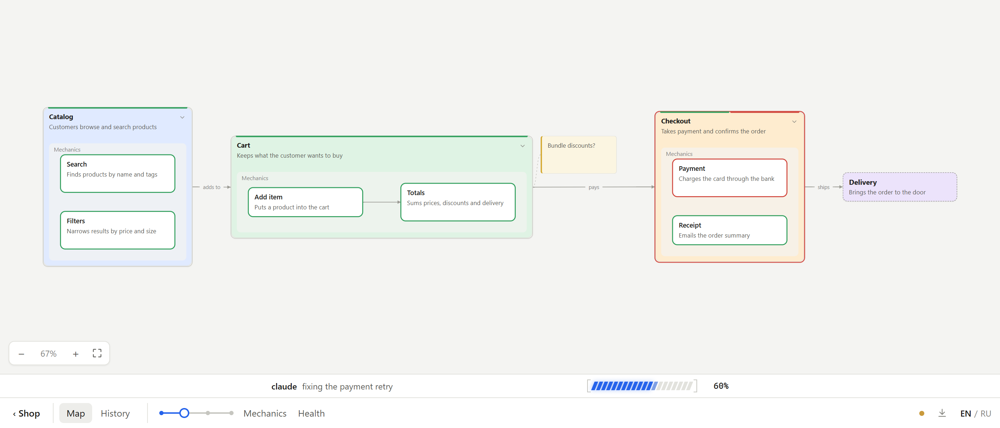

# Mycel

[](https://github.com/mathew5612/mycel/actions/workflows/test.yml) [](LICENSE)

A shared, living map of your project, for you and your AI coding agents. [По-русски](README.ru.md)



Mycel is a local web app with a freeform map: blocks, sticky notes, sub-maps nested inside blocks, and links between them. Your agent (Claude Code, Codex, Cursor, Gemini, a local model and others) connects your project folder by itself, reads the code and draws the map while you watch. The top level shows what the parts of the product are. Inside each part is how it works, in plain words. Below that are the technical details and the code.

The map stays alive afterwards. The agent shows what it is doing and which blocks it is changing. Blocks whose files changed are flagged as possibly outdated, and checks turn blocks green or red as tests run. Your own edits on the map reach the agent before its next step.

> **Language.** Mycel is in English; the interface can also be switched to Russian (EN / RU). The map itself uses whatever language you and your agent write in.

## Why

- **See the whole project at a glance.** A level slider switches between four levels of detail: *concept* and *mechanics* (plain words, readable without programming), then *technique* and *code* (for developers).
- **Talk about blocks, not files.** Select a block and tell your agent "do this here". The agent sees your selection.
- **Know what is going on.** You can see what the agent is doing now and which blocks it is editing. Outdated descriptions, missing checks, failing tests and leftover `TODO`s are flagged too.
- **Plan on the map.** The agent can propose changes as a dashed overlay that you accept or reject. Blocks you add yourself become a plan for the agent.
- **Local and simple.** One Node.js process with no dependencies, no build step, no cloud and no API keys. Data stays in `.mycel/` next to the program, and Mycel writes nothing into your projects.

## Quick start

You need [Node.js](https://nodejs.org) 22 or newer.

```bash
git clone https://github.com/mathew5612/mycel.git
cd mycel
node mycel.mjs open
```

This starts Mycel in the background and opens http://127.0.0.1:4317. On Windows you can also double-click `Mycel.cmd`. On macOS you can double-click `Mycel.command`; run `chmod +x Mycel.command` once first.

Then open your agent in **your project's folder** and give it this line. The "For your agent" line at the top of the Mycel home page copies it for you.

```text
Read the Mycel guide and follow it: curl -s http://127.0.0.1:4317/agent
```

On Windows PowerShell use `curl.exe` instead of `curl`. The agent connects the folder, sets itself up (in Claude Code it installs the Mycel plugin and asks you to start a new session), then builds the map. You keep talking to the agent in its own window: Mycel has no chat.

To update, run `git pull` and then `node mycel.mjs open`. If an older Mycel is still running with the same data, `open` restarts it on the new version. Your maps in `.mycel/` are not touched.

## For AI agents

If a person asked you to set up Mycel for their project:

1. Check that Node.js 22+ is available: `node --version`.
2. Unless Mycel is already running (`curl -s http://127.0.0.1:4317/api/health`), clone it **outside** the project, for example into `~/mycel`. Then start it with `node ~/mycel/mycel.mjs start`. One Mycel serves all projects on the computer.
3. Fetch the guide (`curl -s http://127.0.0.1:4317/agent`, or `node ~/mycel/mycel.mjs guide`) and follow it from the project folder. It has the exact commands for this computer.
4. Tell the person to open http://127.0.0.1:4317 to watch the map.

The ways to connect:

| Agent | How it connects |
| --- | --- |
| Claude Code | `node <mycel>/mycel.mjs plugin --install`: MCP tools, hooks that track edited files, show the agent's task list as a progress bar under the map, and give a session overview |
| Codex, Cursor, Gemini / Antigravity, VS Code, Windsurf, Cline, Claude Desktop | `node <mycel>/mycel.mjs plugin --agent <name>` prints the MCP entry and where it goes |
| Local models (Ollama, LM Studio, llama.cpp, vLLM) | `node <mycel>/mycel.mjs chat`: a built-in agent with all Mycel tools and read-only access to the project files. Client configs: `plugin --agent lmstudio\|continue\|goose\|opencode\|jan\|openwebui` |
| Anything else | The CLI (`node <mycel>/mycel.mjs <command>` from the project folder), function definitions (`mycel tools --format openai\|mcp`, `mycel call <tool> '<json>'`) or the HTTP API |

The main commands are below. `node mycel.mjs --help` lists everything.

```bash
node mycel.mjs init              # connect the current folder (same folder, same project and map)
node mycel.mjs context --brief   # the whole map as Markdown, plus what the person selected and did
node mycel.mjs build map.json    # draw a structure step by step, laid out automatically
node mycel.mjs apply ops.json    # a batch of operations on top of the revision you read
node mycel.mjs wait              # block until the person acts in Mycel or someone else edits the map
node mycel.mjs doing 'reading server.mjs' --progress 40
node mycel.mjs mark cart passed  # plan | testing | passed | failed | none
node mycel.mjs check             # run the blocks' test commands and color them live
node mycel.mjs watch             # flag blocks whose files change, whoever changes them
node mycel.mjs health            # red, outdated, unchecked, planned; TODOs and key-like strings
```

## Using the map

- **Create:** right-click on empty space for a block or a note, or on a block for a block inside it.
- **Link:** drag from any edge of a block (or Alt+drag from anywhere on it) and drop anywhere on another block.
- **Navigate:** double-click a block with a sub-map to dive in, and press Esc to go back up. The slider at the bottom folds the map by level.
- **Hand your edits over:** "Finish edits" sends all your changes to the agent as one event.
- **Proposals:** the agent's suggestions show up dashed and highlighted, with "Accept" and "Reject".
- **History and health:** "History" lists the last 200 changes with author and reason. "Health" highlights what needs attention.

## Virtual machines

Agents inside a VM (VMware, VirtualBox, Hyper-V, WSL) can use the Mycel on your main computer:

- **On the main computer:** run `node mycel.mjs remote on`.
- **In the VM, the agent runs:** `curl -fsS http://<host address>:4317/install.sh | sh`. This installs Node.js if needed and a copy of Mycel, then asks for access with a 4-digit code.
- **You:** check that the code matches and click "Allow" in Mycel. Each machine gets its own key, which you can revoke at any time.

## Privacy and security

- Mycel listens only on `127.0.0.1`. VM access is off until `mycel remote on`, and works only on virtual-network addresses with a per-machine key that you approve.
- Writes through the API need a token kept in `.mycel/token`.
- Nothing is sent anywhere. The only outgoing requests are:
  - `mycel chat` calls the model server you point it at;
  - the VM installer downloads Node.js from nodejs.org and checks its SHA-256.
- Mycel's scans and its built-in local agent skip `.env` files, keys and certificates. Risk reports show only the file and the line number.

## Documentation

- [docs/reference.md](docs/reference.md): the full reference. Covers the interface, every command, the HTTP API and the map format, storage and recovery.
- [src/agent-guide.md](src/agent-guide.md): the guide agents receive at `/agent`.
- [CONCEPT.md](CONCEPT.md): requirements and design decisions. [PROJECT_STATE.md](PROJECT_STATE.md): implementation log.
- [AGENTS.md](AGENTS.md): rules for agents working on Mycel itself.

## Development

```bash
node --test test/*.test.mjs
```

The UI tests drive headless Chrome; they are skipped when Chrome is not found (set `MYCEL_CHROME` to its path). There is no build step. After changing `public/`, reload the page. After changing the server, run `node mycel.mjs stop`, then `node mycel.mjs open`. Tests use temporary folders and free ports and never touch your `.mycel/`.

Mycel is at an early stage (0.22). Issues and pull requests are welcome.

## License

[MIT](LICENSE)
